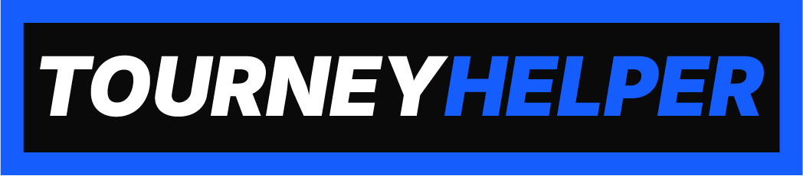

<h4 align="center">🌐<a href="/README.md">English</a> | <a href="/README-RU.md">Русский</a>

  

  

    <b> Software for automating tournament management and participant communication. </b>

    
    
    
    

    
    

# Tourney Helper Website

The official [website](https://dreamervulpi.github.io/tourney-helper-website/) presenting the [**Tourney Helper**](https://github.com/DreamerVulpi/tourney-helper) project — a versatile suite of tools designed to simplify tournament organization.
